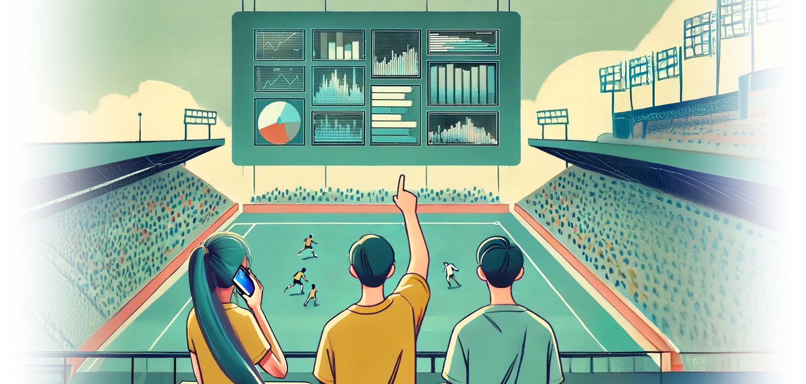

# YUS: Your Ultimate Stats

## Overview

Multiple stat lovers provide running play-by-play commentary on a game of Ultimate;
detailed statistics are derived including team, player, and time-based breakdowns.



## Objectives

* ~Natural language: commentators need not memorize or adhere to strict structure.
* Collaborative: multiple commentators can focus on different parts of the same game.
* Timestamps: all extracted events include time-from-start-of-game.
* Streamed processing: no post-game uploads of large files.
* Accurate names: speech-to-text pre-informed of players to improve accuracy.
* Live stats: see stats develop during the game.

## Approach

### Illustrative Examples

#### Game play vs. Subs

| Commentator #1                                  | Commentator #2                                         |
| ----------------------------------------------- | ------------------------------------------------------ |
| Tristan has the disc.                           | White team starts with Tristan, Joe, Emily, Matt,      |
|                                                 | Drew. Dark team starts with James, Christian, Will,    |
|                                                 | Abby, Parm.                                            |
| Pull!                                           | Tristan Pulls.                                         |
| Parm catches the pull.                          |                                                        |
| Flick to Christian.                             |                                                        |
| Scoob. James catches.                           |                                                        |
| Backhand. Glass. Tristan Ds it.                 |                                                        |
| Tristan picks up for white.                     |                                                        |
| Tristan hammer. Joe scores.                     |                                                        |
| James picks up.                                 |                                                        |
| Backhand huck.                                  | Christian subs off. Angel subs on.                     |
| Off the net. Angel gets it.                     |                                                        |
| Backhand to Parm for a score.                   | Emily subs off. Matt off. Ari and Ben sub on.          |
| ...                                             | ...                                                    |

#### One-to-a-Team

| Commentator #1                                  | Commentator #2                                         |
| ----------------------------------------------- | ------------------------------------------------------ |
| I’m watching white, starting with Tristan,      | I’m watching black shirts. James, Christian,           |
| Joe, Emily, Matt, and Drew. Tristan to pull.    | Will, Abby, Parm on the field to receive.              |
|                                                 |                                                        |
| Tristan pulls!                                  | Go!                                                    |
|                                                 | Parm receives, flicks to Christian.                    |
|                                                 | Christian scoober to James.                            |
|                                                 | Backhand to Will bounces off the glass; turnover.      |
| Tristan knocks it down, picks it up.            |                                                        |
| Hammer huck to Joe in the end zone for a score. | Christian scored on.                                   |
|                                                 | Christian subbing off. James picks up. Angel comes on. |
|                                                 | James puts it deep; bounces off the net.               |
|                                                 | Angel catches.                                         |
| Nobody covering Angel.                          | Short put to Parm in the end zone.                     |
| Drew outpaced by Parm.                          | Emily and Matt subbing off.                            |
|                                                 | Ari on. Ben on.                                        |
| ...                                             | ...                                                    |

#### Commentator per player

…we don’t get a view of the overall game, but anyone who wants to know how often they make certain throws,
or how long they’re on the field, or how much game time they get, or what their completion percentage is,
can get someone to narrate just their performance.

Commentator: _“I’m only watching Tristan. Pull. D. Picks up. Hammer — scores. Subs off. …”_

#### Sole Commentator?

…pretty hard to get both subbing and offense covered when they overlap
(though that’s what happens with per team narration when they subbing on offense).

#### Commentator per player on field?

…hard to get 10 people to cover a full game, also when multiple sub off and on at the same time it's possible
or likely that there will be confusion, causing two people to cover the same player and no one to cover the other.

## Open Questions/Issues

* What if commentator doesn’t know the name of all 11 people on a team, or 22 people on both teams?
  * This is my biggest concern for indoor league. Maybe they just say “someone”?
  * _Now:_ they can say a description (“red shorts”), identified later in the game's descriptions file, on `/admin`,
    or aloud (“red shorts is Kaia”) ([usage.md](docs/usage.md#game-description-files)).

* What if commentator makes a verbal mistake?
  * What are the sorts of things they would make a mistake on, what would they generally say in response?
    * Wrong name: “Joe catches it; flicks to…sorry, that wasn’t Joe, that was Connor to James”
    * Wrong throw type: “dump to Killian; a flick dump”
    * Wrong event “for a score…er, nope, not in, no score”
  * Fast pace of game makes it hard to make a correction in realtime.
  * _Now:_ the extractor takes back a score and replaces a name or receiver in the most recent throw; it does not
    understand a corrected throw type ([extraction.md](docs/extraction.md#how-it-works)).

* How to we fix inconsistent player references?
  * “Federbusch D's the disc. Picked up by Busch for white.”
  * “Blue tank top picks it up … flicked to blue tank … blue top goes deep.”
  * “Stephen Butler has the disc … D'd by Stephen … Butler has catches.”
  * “Killian takes the pull … huck to Killer in the end zone”
  * _Now:_ team files list nicknames and mishearings, and a first or last name unique on the team resolves; a per-game
    descriptions file maps the rest. There is no fuzzy matching.

* What if _N_ commentators provide conflicting data? (Different player names, different accounts of what happened.)
  * _Now:_ merging pairs their events and settles each disagreement by rule: a roster name beats a description, a score
    beats silence, then the commentator following that team, then the majority ([merging.md](docs/merging.md)).

## More Details

* [Architecture](docs/architecture.md) - get a little more technical with the vision.
* [Contributing](docs/CONTRIBUTING.md) - learn how you (yes, you!) can help.

## Running YUS

### Setup

1. Install [uv](https://docs.astral.sh/uv/getting-started/installation/) and `ffmpeg` (macOS: `brew install ffmpeg`).
2. Install the dependencies into `.venv`. On an Apple Silicon Mac (macOS 14+), add the `mlx` extra to run Whisper on the GPU:

   ```bash
   uv sync --extra mlx   # Apple Silicon: mlx-whisper, large-v3-turbo
   uv sync               # elsewhere: faster-whisper, large-v3 (CUDA if available, else CPU)
   ```

   Run the commands below with `uv run`, or after `source .venv/bin/activate`. Whisper's model downloads on first use.
3. Write a team file for each team: official names, real nicknames, and mishearings Whisper keeps making
   (see [Team JSON Files](docs/usage.md#team-json-files); examples in `tests/data/team_*.json`).

### Record a Game Live

```bash
yus-serve --team white.json --team dark.json --ssl-certfile yus.pem --ssl-keyfile yus-key.pem
```

The server prints its links. Its pages:

- `/commentate`: each commentator opens it on a phone, enters a name, picks the team they follow (or both), and taps the
  big button. Their audio streams to the server, which transcribes it, extracts events and merges the commentators.
- `/`: the score, the commentators and the latest events. `/dashboard/`: live stats.
- `/admin`: identify the names and descriptions nobody has matched to a player yet ("red shorts" is Kaia Mann), and
  "Finish game".

Phones only give a page the microphone over HTTPS: [HTTPS for phones](docs/server.md#https-for-phones) covers a local
certificate or a tunnel. Without `--ssl-*`, only a browser on the server's own computer can commentate
(`http://localhost:8000/commentate`). Use `--key` when the server is reachable from the internet. The game is saved in
`games/<start time>/` (transcripts, events, the official stream and the audio), and `--load DIR` resumes it.
Commentators take turns on the GPU: each one's audio is decoded every 3 s alone, every 4.5 s with two, 6.75 s with three
(`--period`, `--period-per-commentator`). On an M3 Pro, two kept the GPU 65% busy; three were not tried
([results](docs/results.md)).

### Process Recordings Afterwards

```bash
yus-game --team white.json --team dark.json --descriptions game-descriptions.json \
    --commentator "Gavin=game.ogg" [--commentator "Sam=sam.ogg:dark" ...]
```

`yus-game` transcribes each recording (or reads a transcript JSON), extracts the events, resolves the names, merges the
commentators and computes the stats. It writes `games/<start time>/`, which `yus-serve --load DIR --asr none` shows on the
dashboard, with `report.html` (score, box scores, points, every event) and `stats/*.csv`. It lists the names nobody has
identified and the team conflicts, to fix in the descriptions file before running it again. A recording whose clock is more
than 20 s off another's needs `NAME=PATH@OFFSET` ([postgame.md](docs/postgame.md)).

One step at a time, for one commentator:

```bash
yus-transcribe game.ogg --team white.json --team dark.json                         # -> game.transcript.json
yus-events game.transcript.json --team white.json --team dark.json                 # -> game.events.json
yus-stats game.events.json --team white.json --team dark.json --descriptions game-descriptions.json
```

- `yus-transcribe` times words from the recording's start: its metadata, or a name like `20250114T2030-0700.ogg`.
- `yus-events` keeps names as spoken and prints any identifications it heard ("red shorts is kaia").
- The [descriptions file](docs/usage.md#game-description-files) says who this game's descriptions mean ("the kid" is
  Serayan Knappe-Butler). `yus-stats` lists the names still unresolved; `--format csv` or `html` writes tables.
- `yus-score` compares events with a hand-made ground truth (see [extraction.md](docs/extraction.md#command-line)).

### Replay a Recording (Demos, Tests)

```bash
yus-serve --team white.json --team dark.json --host 127.0.0.1 --game-dir /tmp/demo
yus-replay game.ogg --commentator Gavin --speed 1          # --speed 0: as fast as possible
yus-replay other.ogg --commentator Sam --focus dark        # optional second commentator, at the same time
```

`yus-replay` streams a file to the server as a phone would. Watch `http://127.0.0.1:8000/dashboard/`, then finish the game
on `/admin`. The game is timed on the day of the replay; `yus-replay` prints when it stamped the file's start, and
`yus-score --shift` maps events back onto the recording ([results.md](docs/results.md#reproducing)).

### Documentation

| doc | covers |
|---|---|
| [architecture.md](docs/architecture.md) | the phases, what is built and what is not |
| [usage.md](docs/usage.md) | `yus-transcribe`, team files, game description files |
| [live_transcription.md](docs/live_transcription.md) | transcribing as audio arrives; `yus-live-transcribe` |
| [extraction.md](docs/extraction.md) | `yus-events` (throws, Ds, substitutions, corrections), `yus-score`. [event_extraction_design.md](docs/event_extraction_design.md) is the first, LLM-based proposal |
| [merging.md](docs/merging.md) | merging commentators' event streams |
| [stats.md](docs/stats.md) | the stats tables, including playing time, plus-minus and lines; `yus-stats` |
| [postgame.md](docs/postgame.md) | `yus-game`: a game's recordings processed afterwards |
| [session.md](docs/session.md) | `GameSession`, which runs the pipeline for one game, and its saved files |
| [server.md](docs/server.md) | `yus-serve`, the commentate page, sharing the GPU, HTTPS, `yus-replay` |
| [dashboard.md](docs/dashboard.md) | the live stats dashboard |
| [results.md](docs/results.md) | the whole pipeline measured on a real game |
| [unlabeled_games.md](docs/unlabeled_games.md) | `yus-game` on ten recordings without ground truth, and how it fails |
| [CONTRIBUTING.md](docs/CONTRIBUTING.md) | how to help; tests run with `uv run pytest -q` |
